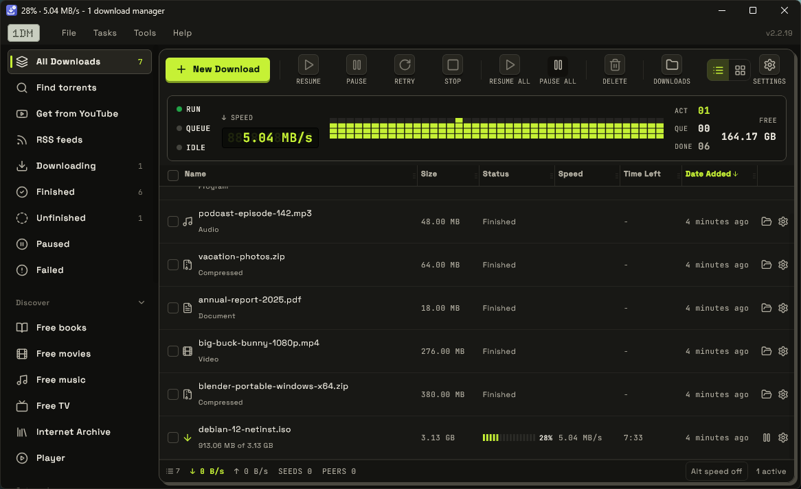
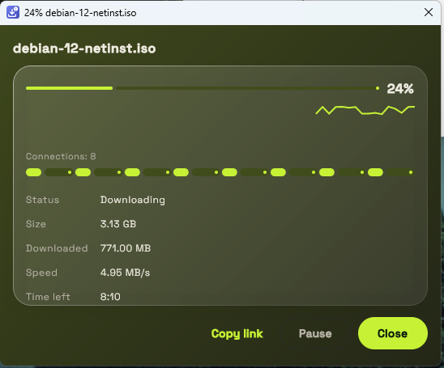
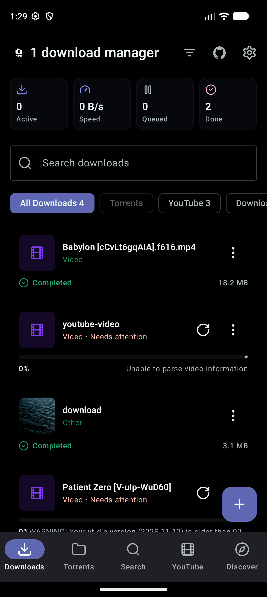
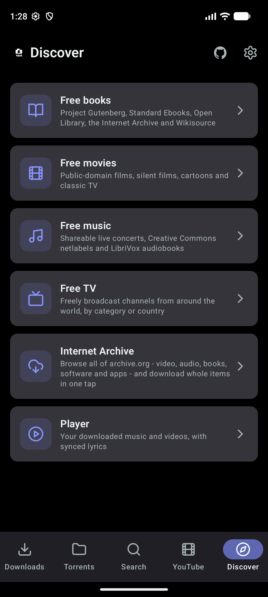
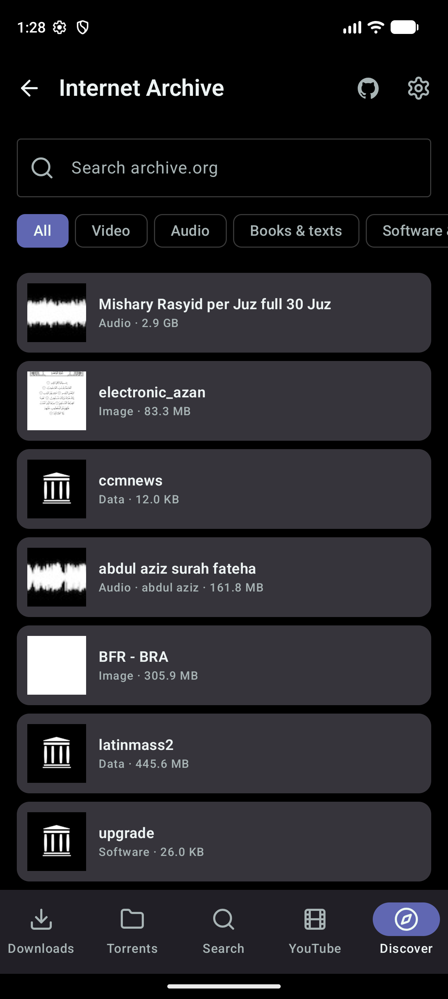
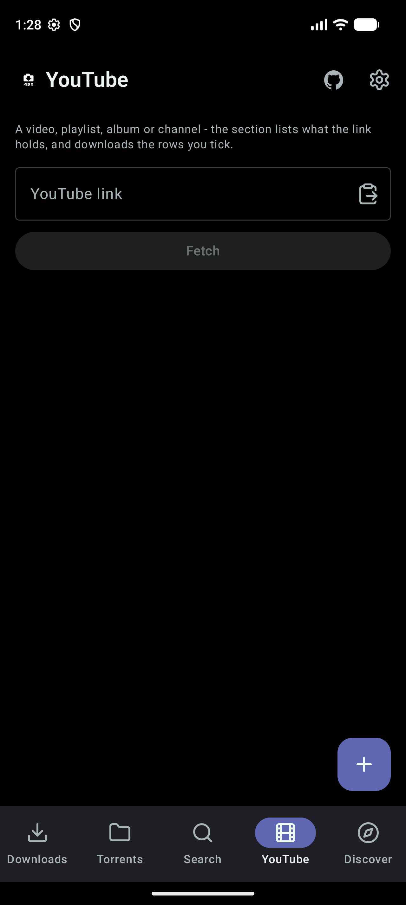

# 1 download manager

**Free, open source, no ads.** One download manager for **Android** and **Windows**: HTTP and FTP links,
YouTube, torrents and streams in a single queue — with browser extensions for Chrome and Firefox.

[**Download the latest release**](https://github.com/RDK456/1-download-manager/releases/latest) ·
[Features](#features) · [Install](#install)



<p>
  
</p>

<p>
  
  
  
  
</p>

## Why people use it

| | |
|---|---|
| **Built for speed** | Every file is split over up to 16 parallel connections (8 by default) with a large read buffer, to use as much of your line as the server allows. When one connection finishes early, it takes over part of the biggest remaining piece. A live graph and connection map show it working. |
| **All-in-one** | Links, YouTube, torrents, HLS/DASH streams, archive.org and free media — one queue, one app, Android and Windows. |
| **Never starts over** | Pause, crash, sleep or lose Wi-Fi — downloads resume where they stopped, and retry on their own. |
| **Watch while it downloads** | Torrents can play in order, so you start the video before it finishes. |
| **Catches everything** | Chrome and Firefox extensions grab downloads and streams from the page. |
| **Yours** | No account and no ads. Open source. |

## Features

**Downloading**
- **Fast, resumable downloads** — segmented HTTP/HTTPS with pause, resume, retry, per-file speed limits and a one-click **slow mode**.
- **FTP** — `ftp://` links download over one connection and resume when the server allows it (plain FTP only, which does not encrypt the password).
- **Mirrors** — on Windows, add spare links to a download; if the main one fails, the next is tried.
- **Self-healing** — retries after a dropped connection or when the PC wakes from sleep; swap an expired link for a fresh one and keep your progress.
- **Batch download** — paste many links at once, or a range like `file[001-120].jpg`. Duplicates are caught for you.
- **Queues and scheduler** — several queues, start and stop times, reorder with move up / down. On Windows each queue has its own retries and "when done" action, and can wake the PC to run.
- **When done** — exit, sleep, hibernate, lock, shut down or open the folder once the queue finishes.

**Video, audio and torrents**
- **YouTube** — videos, whole playlists, albums and channels; pick the quality or save audio as M4A, MP3, Opus or WAV.
- **Stream grabber** — HLS (`.m3u8`) and DASH (`.mpd`) streams are merged into one file (DRM-protected streams are refused).
- **Torrents** — magnet links and `.torrent` files, file selection, and **Play now** to watch while downloading.
- **Internet Archive** — browse all of archive.org and download a whole item in one click.
- **Free books, movies, music and TV** — public-domain and freely licensed sources, plus a built-in player.

**After the download**
- **Checksums** — verify MD5, SHA-1, SHA-256 or SHA-512 on finished files.
- **Auto-unzip and virus scan** — optionally unzip archives and scan new files with Windows Defender.
- **Removed-file tracking** — files deleted outside the app stay in the list, struck through.

**Windows extras**
- **Per-download window** — tabs for status (speed graph, connection map and each connection's progress) and a speed limiter; torrents add files, peers and trackers.
- **Double-click** a finished download to show it in its folder.
- **Limits** — a data allowance over a number of hours, and a connection count of its own for chosen servers.
- **GitHub mirror** — optionally fetch public GitHub files through a mirror you choose, with GitHub as the fallback. Off by default; only use a mirror you trust, as it can change what it serves.
- **Your cache folder** — partial files, helper tools and update downloads go to the folder you pick. Settings, the queue and the app itself stay in their usual places.
- **Control from your phone** — watch and pause downloads from any phone on your Wi-Fi, protected by a PIN.
- **Interface zoom**, system tray, start with Windows, and a glass-style download window.

**Everywhere**
- **Browser integration** — Chrome and Firefox extensions hand downloads and page media to the app, with a per-site exclude list.
- **Automatic updates** — the app checks GitHub and installs new versions for you.
- **Themes** — light, dark and AMOLED, with nine colour palettes.

## Command line and local API (Windows)

Tick **Settings → Local API and command line**. The app writes `dm.ps1` into your cache folder;
with the app running:

```powershell
.\dm.ps1 add "https://example.com/file.zip"
.\dm.ps1 list
.\dm.ps1 pause <id>      # also: resume, remove (keeps files), pause-all, resume-all
```

Other tools can use the same aria2-style JSON-RPC at `http://127.0.0.1:6800/jsonrpc` with the secret
shown in Settings. It covers a subset of aria2: add a link, list and read status, pause, resume and
remove. It is off by default, listens on this computer only and refuses requests from web pages.

## Install

Get the latest version from the [releases page](https://github.com/RDK456/1-download-manager/releases/latest):

| Platform | File |
|---|---|
| Android | `1-download-manager-<version>.apk` (or the `arm64-v8a` / `x86_64` build for a smaller download) |
| Windows | `1-download-manager-<version>.msi`, or the `-portable.zip` to run without installing |
| Chrome / Edge | `1-download-manager-extension-chrome-<version>.zip` |
| Firefox | `1-download-manager-extension-firefox-<version>.xpi` |

The Windows installer needs no administrator rights. For a silent install:
`msiexec /i 1-download-manager-<version>.msi /qn`

## Build from source

Requirements: JDK 17 and the Android SDK (platform 35, build tools 35.0.0). Set `ANDROID_HOME`
or `sdk.dir` in `local.properties`, then:

```text
gradlew test                  # all unit tests
gradlew :app:assembleDebug    # Android APK
gradlew :desktop:run          # run the Windows app
```

The project has three modules: `core` (shared download, torrent and search engines in plain Kotlin),
`app` (Android, Jetpack Compose) and `desktop` (Windows, Compose Multiplatform).
More detail on the build machine setup is in [docs/BUILD-ENVIRONMENT.md](docs/BUILD-ENVIRONMENT.md).

## Releasing

`scripts/release.ps1` bumps the version, runs the tests and lint, builds every asset, commits,
tags, pushes and publishes the GitHub release:

```powershell
.\scripts\release.ps1                          # patch: 2.0.0 -> 2.0.1
.\scripts\release.ps1 -Bump Minor -NotesFile notes.md
```

Release builds are signed with `keystore/` (not in git). **Back up the keystore and its
passwords** — Android only updates an app signed with the same key.

## Legal

Only download content you own or have permission to download. See
[LICENSE-NOTICE.md](LICENSE-NOTICE.md) for third-party licences.
